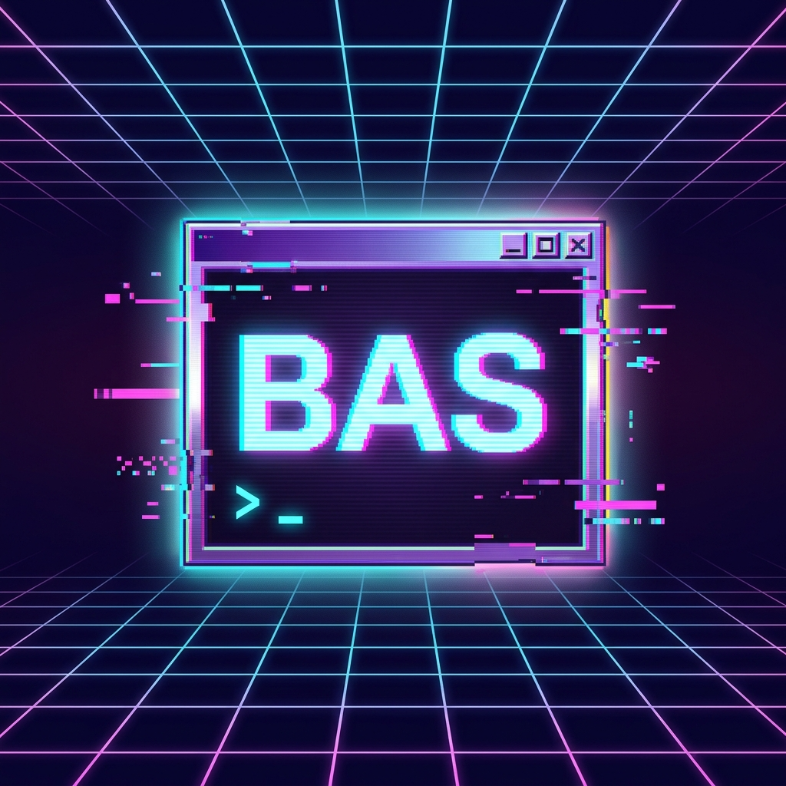

<p align="center">
  
</p>

# Britt's Agent Skills

A collection of skills for coding agents to enhance AI-assisted development workflows.

## Skills Included

### Development Workflow

| Skill | Description | Claude Code | Claude.ai |
|-------|-------------|:-----------:|:---------:|
| **sgai-goal** | Compose GOAL.md files for SGAI workspaces through interactive conversation | * | |
| **setting-up-a-project** | Author CLAUDE.md and AGENTS.md with project purpose, tech stack, and development practices | * | |
| **repairing-project-setup** | Audit a repo against what setting-up-a-project would generate and repair only the gaps | * | |
| **working-on-an-issue** | Implement a GitHub issue hands-off, with scoped recon and a PR as the approval gate | * | |
| **working-on-an-epic** | Coordinate an epic: child issues run in parallel agent workspaces, tracked to reviewable PRs | * | |
| **supervising-conductor-workspaces** | Dispatch one agent workspace per issue and supervise their PRs to merge: keep them current, resolve conflicts, rerun flaky CI, archive when merged | * | |
| **supervising-paradev-workspaces** | The same fleet supervision driven by the Paradev CLI: one Paradev workspace per issue, watched to merge | * | |
| **project-analysis** | Analyze project codebase structure, architecture, key files, and dependencies | * | * |
| **project-planning** | Orchestrate end-to-end project planning with issues, diagrams, dependencies, and timelines | * | * |
| **issue-decomposition** | Decompose projects into well-structured GitHub issues with user stories and estimates | * | * |
| **estimating-work-items** | Size issues with story points on a powers-of-two scale and total epics from their children, recorded as a label, an Estimate section, and a project field | * | * |
| **estimating-change-footprint** | Estimate an issue's change footprint (lines changed and files read, each bucketed) to predict coding-agent token spend, recorded as labels, a Footprint section, and a project field | * | |
| **dependency-mapping** | Generate Mermaid dependency graphs showing issue relationships and critical paths | * | * |
| **timeline-planning** | Generate Mermaid Gantt charts for project timelines with phases and milestones | * | * |

### Requirements & Planning

| Skill | Description | Claude Code | Claude.ai |
|-------|-------------|:-----------:|:---------:|
| **requirement-elicitation** | Conversational wizard for eliciting functional, nonfunctional, and edge-case requirements | * | * |
| **idea-to-design** | Turn an idea note into a design document | * | * |
| **writing-product-specs** | Write comprehensive product specification documents | * | * |
| **writing-user-stories** | Write properly formatted user stories with Given-When-Then acceptance criteria and an INVEST quality checklist | * | * |
| **writing-verification-plans** | Acceptance test verification plans (real-world testing, never mocks) | * | * |
| **context-aware-questions** | Identify information gaps and generate questions to surface missing requirements | * | * |

### Project Management

| Skill | Description | Claude Code | Claude.ai |
|-------|-------------|:-----------:|:---------:|
| **at-risk-detection** | Identify at-risk issues and PRs: stale items, blocked work, deadline risks, scope creep | * | * |
| **triage-new-issues** | Review new GitHub issues, assess priority, suggest labels, and recommend assignees | * | * |
| **stakeholder-tracking** | Define stakeholder personas and track their goals | * | * |
| **stakeholder-updates** | Craft clear, concise stakeholder communications | * | * |
| **prepare-meeting-agenda** | Generate time-boxed meeting agendas from recent issues, PRs, and notes, saved as dated files so action items carry over | * | * |

### Documentation & Communication

| Skill | Description | Claude Code | Claude.ai |
|-------|-------------|:-----------:|:---------:|
| **architecture-diagramming** | Generate Mermaid architecture diagrams showing system components and data flows | * | * |
| **mermaid-diagrams** | Guide for creating syntactically correct Mermaid diagrams for GitHub | * | * |
| **markdown-formatting** | Format AI outputs into consistent, readable Markdown | * | * |
| **build-faq-from-issues** | Extract common questions from closed issues and generate an FAQ document | * | * |
| **summarize-conversation-thread** | Summarize GitHub issue/PR threads into key decisions and action items | * | * |
| **research-topic-summarize** | Research topics via web search and synthesize detailed summaries with sources | * | * |

### Personal & Utilities

| Skill | Description | Claude Code | Claude.ai |
|-------|-------------|:-----------:|:---------:|
| **daily-planning-ritual** | Interactive daily planning across work and personal life dimensions | * | * |

## Installation

### Claude Code: Plugin Marketplace (Recommended)

Add this repository as a plugin marketplace:

```bash
/plugin marketplace add britt/britts-agent-skills
```

> **Migrating from `agent-skills@britt`:** three things were renamed — the repository
> (`britt/agent-skills` → `britt/britts-agent-skills`), the marketplace (`britt` →
> `britts-agent-skills`), and the full bundle (`agent-skills` → `britts-agent-skills`).
> Claude Code registers one marketplace per name and offers no migration for a renamed
> marketplace, so remove the old registration and add it again:
>
> ```bash
> /plugin marketplace remove britt
> /plugin marketplace add britt/britts-agent-skills
> /plugin install britts-agent-skills@britts-agent-skills
> ```
>
> The bundle rename is migrated for you: the marketplace's `renames` field maps
> `agent-skills` to `britts-agent-skills`. Skills are namespaced under the plugin name, so
> references like `agent-skills:working-on-an-issue` in a CLAUDE.md become
> `britts-agent-skills:working-on-an-issue`. The curated bundles (`project-foundations`,
> `llpm`, `chat`) and every individual skill name are unchanged.

**Install all skills:**

```bash
/plugin install britts-agent-skills@britts-agent-skills
```

**Install a curated bundle:**

```bash
# project-foundations: setup and analysis, issue decomposition, story-point
# and change-footprint estimates, user stories, verification plans,
# architecture/dependency/Mermaid diagrams, and agent-driven work on
# issues and epics
/plugin install project-foundations@britts-agent-skills

# llpm: product/project-management skills - requirements, specs, user
# stories, stakeholders, meetings, triage, risk, timeline/dependency planning,
# and the project-planning orchestrator (add architecture-diagramming separately)
/plugin install llpm@britts-agent-skills

# chat: for chat agents rather than coding agents - writing and
# communication, research, diagrams, requirements, specs, and daily planning.
# Nothing in it needs a repository, git, or the gh CLI.
/plugin install chat@britts-agent-skills
```

**Install individual skills:**

```bash
/plugin install architecture-diagramming@britts-agent-skills
/plugin install at-risk-detection@britts-agent-skills
/plugin install build-faq-from-issues@britts-agent-skills
/plugin install context-aware-questions@britts-agent-skills
/plugin install dependency-mapping@britts-agent-skills
/plugin install estimating-change-footprint@britts-agent-skills
/plugin install estimating-work-items@britts-agent-skills
/plugin install idea-to-design@britts-agent-skills
/plugin install issue-decomposition@britts-agent-skills
/plugin install markdown-formatting@britts-agent-skills
/plugin install mermaid-diagrams@britts-agent-skills
/plugin install prepare-meeting-agenda@britts-agent-skills
/plugin install project-analysis@britts-agent-skills
/plugin install project-planning@britts-agent-skills
/plugin install requirement-elicitation@britts-agent-skills
/plugin install research-topic-summarize@britts-agent-skills
/plugin install stakeholder-tracking@britts-agent-skills
/plugin install stakeholder-updates@britts-agent-skills
/plugin install summarize-conversation-thread@britts-agent-skills
/plugin install timeline-planning@britts-agent-skills
/plugin install triage-new-issues@britts-agent-skills
/plugin install working-on-an-issue@britts-agent-skills
/plugin install working-on-an-epic@britts-agent-skills
/plugin install supervising-conductor-workspaces@britts-agent-skills
/plugin install supervising-paradev-workspaces@britts-agent-skills
```

**Some skills are only available via a bundle**, not standalone: `daily-planning-ritual`, `repairing-project-setup`, `setting-up-a-project`, `sgai-goal`, `writing-product-specs`, `writing-user-stories`, `writing-verification-plans`. Install `britts-agent-skills@britts-agent-skills` to get all of these, `project-foundations@britts-agent-skills` for the project-setup and user-story/verification skills, `llpm@britts-agent-skills` for `writing-product-specs`, `writing-user-stories`, and `writing-verification-plans`, or `chat@britts-agent-skills` for `daily-planning-ritual`, `writing-product-specs`, and `writing-user-stories`.

### Claude Code: Manual Installation

Skills can be installed globally or per-project.

**Global installation** (available in all projects):

```bash
# Clone the entire repository
git clone https://github.com/britt/britts-agent-skills.git ~/.claude/skills/agent-skills
```

**Project-specific installation**:

```bash
# Clone the entire repository into the project
git clone https://github.com/britt/britts-agent-skills.git .claude/skills/agent-skills
```

Restart Claude Code after installation to load new skills.

### Codex CLI

This repo is a Codex plugin marketplace (`.codex-plugin/plugin.json` + the existing `.claude-plugin/marketplace.json`, which Codex also reads):

```bash
codex plugin marketplace add britt/britts-agent-skills
codex plugin install britts-agent-skills@britts-agent-skills        # all skills
codex plugin install project-foundations@britts-agent-skills       # curated bundle only
codex plugin install llpm@britts-agent-skills                      # curated bundle only
codex plugin install chat@britts-agent-skills                      # curated bundle only
```

### Cursor

This repo ships a native Cursor plugin manifest (`.cursor-plugin/plugin.json`) and marketplace catalog (`.cursor-plugin/marketplace.json`). Cursor's marketplace-add flow is dashboard-based (no CLI yet): **Dashboard → Plugins → Team Marketplaces → Add Marketplace → Import from Repo**, pointing at `britt/britts-agent-skills`, then install `agent-skills` (or `project-foundations`, `llpm`, `chat`) from **Customize** in the sidebar.

### Paradev

This repo is also a Paradev plugin marketplace (`.agent-marketplace.json`, plus a `plugin.json` in each bundle under `bundles/`):

```bash
paradev plugins marketplace add britt/britts-agent-skills
paradev plugins install britts-agent-skills@britts-agent-skills    # all skills
paradev plugins install project-foundations@britts-agent-skills    # curated bundle only
paradev plugins install llpm@britts-agent-skills                   # curated bundle only
paradev plugins install chat@britts-agent-skills                   # curated bundle only
```

Paradev requires every plugin to live in its own directory inside the marketplace root, so the full library is published from `bundles/britts-agent-skills/` (a single `skills` symlink back to the canonical `skills/`) rather than from `./` the way the Claude, Codex, and Cursor manifests do. The skills are the same either way.

### Codex CLI, OpenCode, and Cursor: Manual Installation

All three also discover skills the same way Claude Code does — a `SKILL.md` with `name`/`description` frontmatter, auto-triggered by relevance — under the shared `.agents/skills/` path. This repo already exposes every skill there (`.agents/skills/<name>` symlinked to `skills/<name>`, so there's only ever one copy of each skill's content). This is the option to use for OpenCode, which has no marketplace, or if you'd rather not use Codex's/Cursor's plugin flow above.

**Global installation** (available in all projects):

```bash
git clone https://github.com/britt/britts-agent-skills.git ~/.agents-skills-src
mkdir -p ~/.agents/skills
for dir in ~/.agents-skills-src/skills/*/; do
  ln -s "$dir" ~/.agents/skills/"$(basename "$dir")"
done
```

**Project-specific installation**: clone into the project and symlink, or run `./sync-agents-skills.sh` after copying `skills/` into your project's own `.agents/skills/`.

Codex CLI also reads `~/.codex/AGENTS.md` / project `AGENTS.md`, OpenCode reads `AGENTS.md` and natively falls back to `.claude/skills/`, and Cursor also reads `.cursor/skills/` — so a plain `git clone` into any of those tool-specific directories works too. Restart the tool after installation to load new skills.

**Note:** Some skills (like `sgai-goal`) reference Claude Code-specific tooling (e.g. `CLAUDE.md`, `TodoWrite`) and may need minor adaptation to work identically in other tools; most skills are plain instructional markdown and are unaffected. `setting-up-a-project` is multi-agent aware — it writes both a `CLAUDE.md` and an `AGENTS.md` adapted for Codex CLI, OpenCode, and Cursor. Granular per-skill plugin installs (like `/plugin install architecture-diagramming@britts-agent-skills` for Claude Code) aren't set up for Codex/Cursor yet — only the two bundles above; use the manual `.agents/skills/` installation for individual-skill granularity on those tools.

### Claude.ai (Web and iOS)

Skills can be added to Claude.ai projects as project knowledge:

1. **Download the skill zip file**
   - Go to the [Releases page](https://github.com/britt/britts-agent-skills/releases/)
   - Download the zip file for the skill you want (e.g., `writing-product-specs.zip`)

2. **Add to your Claude.ai project**
   - Open [claude.ai](https://claude.ai) and go to your project
   - Click on **Project knowledge** in the sidebar
   - Upload the zip file

3. **Use the skill**
   - The skill will be available in all conversations within that project
   - Claude will automatically use it when the context matches the skill's description

**Note:** Some skills (like `sgai-goal` and `setting-up-a-project`) require Claude Code-specific features and won't work in Claude.ai.

## Rules

The `rules/` directory contains reusable rule sets that can be dropped into your project.

### TDD.rules.md

Strict Test-Driven Development rules for coding agents. Used by the `setting-up-a-project` skill, which references them from both `CLAUDE.md` and `AGENTS.md`.

**Key rules:**
- No production code without a failing test first (RED-GREEN-REFACTOR)
- 90%+ test coverage required on all metrics (configurable)
- Violations mean delete and start over
- Tasks aren't complete until tests pass, build succeeds, and no linter errors

**Usage:** The `setting-up-a-project` skill copies this file to your project root and fills in its placeholders, then references it from CLAUDE.md as `@TDD.rules.md`. You can also copy it manually:

```bash
curl -o TDD.rules.md \
  https://raw.githubusercontent.com/britt/britts-agent-skills/main/rules/TDD.rules.md
```

Replace every `{{PLACEHOLDER}}` (`{{TEST_COMMAND}}`, `{{BUILD_COMMAND}}`, coverage thresholds, test file convention) with values for your tech stack.

`rules/TDD.rules.md` is a mirror. The canonical copy lives at `skills/setting-up-a-project/TDD.rules.md` so single-skill installs stay self-contained; `./sync-agents-skills.sh` refreshes the mirror.

### CLAUDE-specific-fuckups.md

A running list of mistakes Claude Code makes repeatedly, tied to gaps in its training data rather than general project conventions. Grows over time as new patterns are found; entry 1 is checking for outdated GitHub Actions versions and deprecated runtimes before adding or editing a `uses:` step.

**Usage:** The `setting-up-a-project` skill copies this file to your project root verbatim and references it from `CLAUDE.md` as `@CLAUDE-specific-fuckups.md`. It is Claude Code-specific and is not referenced from `AGENTS.md`. You can also copy it manually:

```bash
curl -o CLAUDE-specific-fuckups.md \
  https://raw.githubusercontent.com/britt/britts-agent-skills/main/rules/CLAUDE-specific-fuckups.md
```

`rules/CLAUDE-specific-fuckups.md` is a mirror. The canonical copy lives at `skills/setting-up-a-project/CLAUDE-specific-fuckups.md`; `./sync-agents-skills.sh` refreshes the mirror.

## Documentation

- [Contributing Guide](CONTRIBUTING.md) - Repository structure, creating skills, and contribution guidelines
- [Claude Code Skills Documentation](https://docs.claude.com/en/docs/claude-code/skills) - Official documentation

## License

[MIT](LICENSE)
